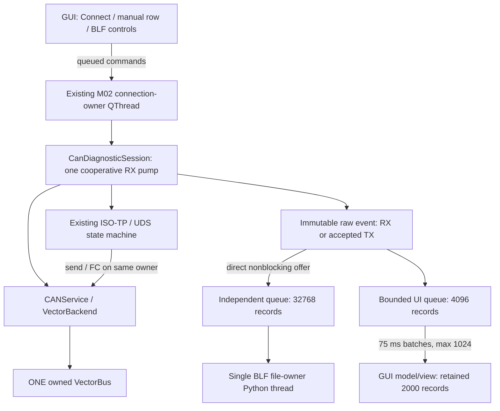
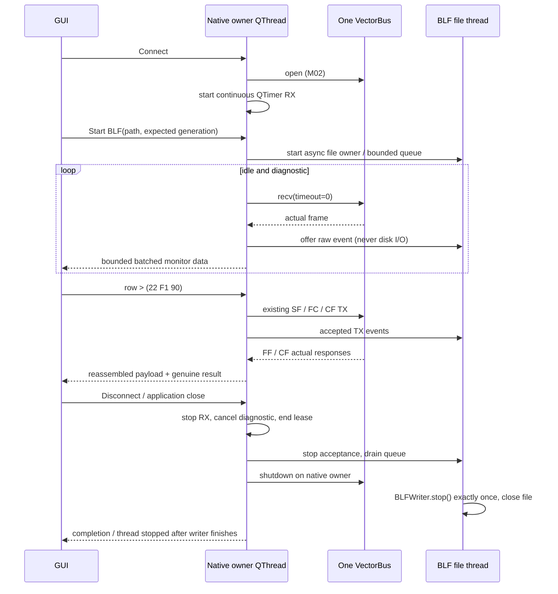

# CAN Interface M04-B — Continuous Monitor và BLF Recording

Ngày: 2026-10-26. Baseline: commit 57,
`87b3cb37ecd5cf406bff5d3c2cf49462bbda0159`.
Triển khai theo `.codex/skills/can-m04b-continuous-can-blf/SKILL.md`.
Không commit/push. Không thay đổi ISO-TP engine, UDS client, ECU resolver,
Vehicle Manager, Save Order, licensing hoặc database schema.

## Kết quả theo phase

| Phase | Kết quả |
|---|---|
| B01 | Mở rộng immutable `CanFrameView`: connection UUID, sequence, timestamp nguồn, local/source channel và liên kết TX echo |
| B02 | RX pump duy nhất chạy từ Connect đến Disconnect, cả khi không có UDS |
| B03 | Recorder BLF có queue riêng, file-owner thread riêng, Start/Stop/finalization và báo INCOMPLETE |
| B04 | Nối nút BLF hiện có; CAN Monitor chuyển sang QTableView/model, giữ cột, filter và shared styles |
| B05 | CSV UTF-8 BOM từ retained view có áp dụng filter; không phụ thuộc recorder |
| B06 | Fake-bus E2E, fault/race/drop tests, BLF round-trip, regression và visual QA |

## Kiến trúc và ownership



Chỉ `VectorBackend.fn_receive_frame()` gọi native `bus.recv(timeout=0.0)`.
Idle và diagnostic dùng cùng pump, không có notifier/receiver khác.
Pump xử lý tối đa 32 RX mỗi tick 2 ms; warm-up trước TX vẫn giữ giới hạn M04.
Idle capture không giữ diagnostic operation lease. Request đang chạy vẫn dùng
lease, transport callbacks, SF/FF/FC/CF, matching, NRC 0x78 và cancellation M04.
Kết thúc/cancel UDS không dừng idle monitoring.

Start BLF đi qua queued slot trên owner, kiểm tra lại CONNECTED, monitoring và
connection generation. Không quyết định mở file trên GUI dựa vào snapshot cũ.
Recorder nhận event trực tiếp trước UI fan-out, cả trong STARTING; file mở chậm
không làm bỏ những frame đã được nhận sau ranh giới Start trên owner.



## Timestamp, channel và echo

- Mỗi Connect tạo một wall/monotonic anchor, session UUID và sequence tăng dần.
- RX giữ Unix timestamp từ driver khi hữu hạn và trong một ngày so với anchor.
  Thiếu/không hợp lệ dùng anchored monotonic fallback, gắn `timestamp_source`.
- TX timestamp là thời điểm ứng dụng ghi nhận driver đã chấp nhận `send()`;
  không phải bằng chứng ACK trên bus hoặc timestamp phần cứng.
- Canonical time không giảm theo acquisition order. Timestamp đến muộn bị clamp
  có nhãn `*_clamped`, đếm riêng; timestamp gốc giữ trong `source_timestamp_s`.
  Tooltip cho thấy cả hai. BLF dùng canonical wall time; không xuất elapsed Time(s)
  làm Unix time. BLF không lưu được tất cả metadata phụ của raw event.
- Stale-response gate của UDS dùng timestamp driver gốc, không dùng giá trị clamp.
  Vì vậy chuẩn hóa log không biến một response cũ thành response của request mới.
- Canonical channel là selected zero-based local CAN port, không phải ECU CAN ID
  hay global `channel_index`. Metadata nguồn giữ riêng. RX có channel khác port
  đã chọn bị từ chối rõ ràng và recording bị đánh dấu INCOMPLETE.
- Đã đọc source python-can **4.6.1**: BLFWriter cộng 1 vào `Message.channel`;
  BLFReader trừ 1. Local 0 → BLF channel 1 → Reader 0; local 1 → BLF channel 2
  → Reader 1. Reader của V-CODE tiếp tục hiển thị logical channel 1/2.
- Backend liên kết observed TX echo với accepted TX cùng ID/bytes/extended trong
  một giây, tối đa 256 pending TX. Recorder chỉ bỏ echo khi TX gốc đã được nhận
  trong **chính phiên ghi này**. Echo của TX trước Start vẫn được ghi.
- GUI giữ cả accepted TX và observed echo với origin riêng. Không dedup RX theo
  nội dung: các frame 0x760 giống nhau vẫn là các record riêng.

Độ chính xác thời gian phụ thuộc driver/clock; không tạo độ chính xác nanosecond
phần cứng từ polling. Clamp/fallback được đếm và hiển thị trong tooltip trạng thái.
Echo correlation có giới hạn: TX của ứng dụng khác trùng hoàn toàn trong cùng cửa
sổ không thể phân biệt tuyệt đối qua python-can Message hiện tại.

## Recorder, lỗi và cleanup

State: STOPPED → STARTING → RECORDING → STOPPING → STOPPED; lỗi → INCOMPLETE.
`complete` chỉ đúng sau finalization, không có error/drop và captured == written.

- Queue recording 32768 độc lập queue GUI 4096 và retained view 2000. Overflow
  GUI chỉ tăng counter GUI. Overflow recorder dừng acceptance, ghi lỗi, đếm frame
  bị từ chối và drain những record đã nhận; không báo Saved/Complete.
- Queue dùng `put_nowait`; CAN/ISO-TP không chờ đĩa. Writer chạy một thread riêng,
  chỉ nhận immutable event, không truy cập bus hoặc QWidget.
- Captured là logical events được nhận trong phiên (không tính paired echo).
  Written là số event được BLFWriter chấp nhận; chỉ sau finalization mới xác nhận
  file hoàn chỉnh. Các số này không bảo đảm dữ liệu đã fsync xuống thiết bị lưu trữ.
- Stop được tuần tự hóa trên owner, kể cả Start rồi Stop ngay lập tức. Dừng nhận
  mới, drain FIFO rồi gọi BLFWriter.stop() một lần. Empty session giữ file BLF rỗng
  hợp lệ. Không dùng append, không xóa file cũ khi mở phiên tiếp theo.
- Destination mặc định: `output/CAN_Interface_Logs/`.
  Filename `V_CODE_CAN_<sanitized_vehicle>_<date_time_microseconds>.blf`.
  Exclusive `xb+` chống ghi đè/race; chỉ dùng `wb+` khi người dùng xác nhận thay file.
- Lỗi open, write/Errno 28, invalid timestamp/channel/session, queue overflow,
  flush/header finalization hoặc close đều được báo INCOMPLETE. Giữ file lỗi để
  kiểm tra; không tuyên bố file đó đầy đủ/đọc được.
- Acquisition/conversion failure đánh dấu recorder lỗi **trước** native cleanup,
  cả khi đang chạy UDS. Vì vậy Stop đồng thời không che mất lỗi unplug.
- Disconnect dừng RX trước shutdown bus; finalization đĩa độc lập native resource
  state. M02 RECOVERY_REQUIRED được giữ nếu shutdown không chắc chắn. GUI vẫn
  xử lý event khi chờ writer; không terminate QThread cưỡng bức.
- Không thể bảo đảm hardware/driver chưa làm mất frame trước khi giao cho Python.
  Complete xác nhận pipeline phần mềm đã nhận, không phải chứng nhận lossless toàn bus.
  OS/vendor call bị treo vô hạn không thể được hủy an toàn; ứng dụng chờ finalization
  thay vì giả báo đã đóng sạch hoặc bỏ một writer đang ghi.

## UI và CSV

Giữ splitter, toolbar, bảng diagnostic, Vehicle Manager và Save Order. Status
hiển thị Monitoring/Stopped và RECORDING/STOPPING/INCOMPLETE; tooltip có path,
capture/write/drop/echo/timestamp counters và lỗi. Run Selected vẫn disabled.

Monitor dùng QTableView/QAbstractTableModel vì phép đo QTableWidget cho thấy
heartbeat gap hơn 1 giây. Model format cell khi view yêu cầu, remove prefix/append
tail theo batch, giữ selection của record chưa bị eviction. Shared table CSS,
ThemeManager, mono data font và scrollbar styles được tái sử dụng. Không tạo lại
hàng nghìn QTableWidgetItem mỗi batch.

CSV là snapshot retained frames **có áp dụng CAN ID/direction filter**, UTF-8 BOM,
csv.writer quoting; 9 cột theo skill. Clear/filter chỉ tác động GUI. CSV bao gồm raw
event đang giữ trong view (có thể có observed echo), không phải bản lossless của BLF.

## File thay đổi

| File | Mục đích |
|---|---|
| `config/paths.py` | Output directory cho CAN logs |
| `core/can_interface_view.py` | Raw event metadata, tương thích các field cũ |
| `services/can/vector_backend.py` | Acquisition timestamp/channel/sequence/echo policy |
| `services/can/can_service.py` | Idle capture API không giữ diagnostic lease |
| `services/can/blf_recording_service.py` (mới) | Independent writer lifecycle, conversion, queue, counters |
| `services/can/can_csv_export.py` (mới) | Retained CSV export |
| `gui/workers/can_diagnostic_session.py` | Continuous RX, capture fan-out, pre-cleanup fault notification |
| `gui/workers/can_connection_worker.py` | Owner commands, Start/Stop ordering, await writer finalization |
| `gui/controllers/can_diagnostic_controller.py` | Giữ monitor state độc lập trạng thái request |
| `gui/controllers/can_recording_controller.py` (mới) | Save dialogs, controls, polling immutable snapshot |
| `gui/widgets/can_interface/can_monitor_model.py` (mới) | Lazy model/view, incremental batches |
| `gui/widgets/can_interface/can_monitor_panel.py` | Status/controls/filter/retained snapshot |
| `gui/tabs/can_interface_tab.py` | Composition và close controller |
| `tests/services/test_can_raw_capture.py` (mới) | Metadata, clock, channel và reconnect generation |
| `tests/services/test_blf_recording_service.py` (mới) | Round-trip, flags, early/late echo, open/write/stop/overflow |
| `tests/services/test_can_csv_export.py` (mới) | CSV BOM/schema/value/no-overwrite |
| `tests/gui/test_can_continuous_capture.py` (mới) | Idle/UDS/capture/error/lifecycle/UI/performance E2E |
| `tests/gui/test_can_monitor_model.py` (mới) | Qt model tester, incremental selection identity |
| `tests/gui/test_can_monitor_panel.py` | Chuyển assertion sang model API |
| `tests/gui/test_can_diagnostic_execution.py` | M04B chủ động enable BLF/CSV sau Connect/capture |
| `docs/can_interface/M04B_CAN_MONITOR_BLF_REPORT.md` | Báo cáo này |

## Verification

Kết quả thực tế:

| Nhóm | Kết quả |
|---|---|
| M01/M02/M03/M04/M04B + native sequence + BLF reader/channel/pipeline | **225 PASS**, 52,496 giây |
| Coding Value Save Order/theme + Vehicle Service | **19 PASS**, 9,864 giây |
| Checkpoint UI cuối sau sửa status bị chồng nút | **2 PASS**, 1,350 giây |
| Recorder sau kiểm tra lazy dependency import | **7 PASS**, 0,359 giây |
| Review độc lập lần hai | Không còn substantive finding ở các boundary/lifecycle đã sửa |
| Whitespace / Python compilation | `git diff --check` pass; py_compile **20** file Python thay đổi |
| Missing dependency startup | Import CAN tab thành công khi giả lập không có python-can; BLF import được trì hoãn đến file worker |

Không có test fail còn lại trong các nhóm đã chọn. Không chạy toàn bộ test suite
của các tab không liên quan. Các lỗi trong lượt RED là lỗi tái hiện trước sửa,
không phải kết quả cuối. Các file tạm của test RED đã được đóng/dọn.

Lệnh regression chính (chạy từ workspace với project `.venv`):

```powershell
.venv\Scripts\python.exe -m unittest `
  tests.services.test_can_service tests.services.test_can_connection `
  tests.services.test_owned_vector_bus tests.services.test_vector_discovery `
  tests.services.test_can_diagnostic_io tests.services.test_ecu_diagnostic_resolver `
  tests.services.test_isotp_transport tests.services.test_diagnostic_client `
  tests.services.test_can_raw_capture tests.services.test_blf_recording_service `
  tests.services.test_can_csv_export tests.gui.test_can_connection_worker `
  tests.gui.test_can_connection_tab tests.gui.test_can_discovery_worker `
  tests.gui.test_can_interface_tab tests.gui.test_can_interface_layout `
  tests.gui.test_can_session_panel tests.gui.test_can_sequence_sidebar `
  tests.gui.test_can_workspace_controller tests.gui.test_can_diagnostic_table_panel `
  tests.gui.test_can_monitor_panel tests.gui.test_can_monitor_model `
  tests.gui.test_can_diagnostic_execution tests.gui.test_can_continuous_capture `
  tests.core.test_diagnostic_sequence_import tests.repositories.test_diagnostic_sequence_repository `
  tests.gui.test_diagnostic_sequence_list tests.gui.test_diagnostic_sequence_table `
  tests.core.test_blf_reader tests.core.test_log_channels tests.core.test_pipeline_channel_flow

.venv\Scripts\python.exe -m unittest `
  tests.gui.test_coding_workspace_reorder tests.gui.test_coding_value_theme_refresh `
  tests.services.test_vehicle_service tests.services.test_vehicle_service_save `
  tests.services.test_vehicle_service_export
```

Lượt chạy dùng cùng selection qua `unittest.defaultTestLoader.loadTestsFromNames`
và root `logging.NullHandler` để các fault injection không in traceback dự kiến.
Không disable logging toàn cục; các `assertLogs` vẫn hoạt động.

Đo tải fake bus 5.000 frame, cửa sổ hiển thị 1366×768: lượt full suite ghi đủ
5.000 frame trong **2,485 giây**, max GUI heartbeat gap **0,094 giây**, recorder
drop **0**; GUI giữ tối đa 2.000 frame và có eviction riêng. Các checkpoint khác
đo khoảng 0,42–2,49 giây và heartbeat gap 0,032–0,328 giây tùy tải máy. Đây là
phép đo ứng dụng/fake bus, không phải chứng nhận throughput hoặc timing Vector.

Các test RED đã tái hiện idle traffic không hiển thị, metadata thiếu, recorder chưa
có, stale start, capture loss báo Complete, lỗi unplug bị che khi Stop và mất echo
có TX gốc trước Start. Sau sửa, các checkpoint tương ứng đã pass.

BLF round-trip dùng **recorder thật**, không chỉ smoke-test can.BLFWriter:
IDs/data/DLC/direction, extended/RTR/RX-error flags, local channel 0/1, Unix time
và relative delta, frame count/order; đọc thêm bằng `core.blf_reader.load_blf`.
TX error-frame bị từ chối vì codec CAN_ERROR_EXT của python-can 4.6.1 không giữ
được hướng TX. Các lỗi serializer không được báo capture hoàn chỉnh.

Visual QA có bốn ảnh fake-bus tại `output/qa_can_m04b/`, Light/Dark,
1366×768 và 1600×900. Ảnh có Passed chỉ từ fixture bus; không phải ảnh xe thật.

## Hardware acceptance — tách riêng

**Người dùng đã báo M04 Vector UDS 22 F1 90 và multi-frame response hoạt động trên
phần cứng. Agent không tự thực hiện hay xác minh lại capture đó.**

M04-B hardware và CANoe/TSMaster **chưa kiểm thử**. Cần ghi lại evidence/version:

- [ ] VN1630A/VN1640A, XL Driver version, serial/local port/global channel index.
- [ ] Sau Connect, thấy idle periodic traffic mà không gửi UDS.
- [ ] Start BLF trước Read VIN; kiểm tra SF → FF → FC → CF1/CF2 trên trace ngoài.
- [ ] Stop và mở đúng file bằng BLFReader và V-CODE Log Analyzer.
- [ ] Thử port CAN 1/2; xác minh hướng, timestamp và channel đúng với external capture.
- [ ] Mở file trong CANoe (ghi version) và TSMaster (ghi version), so sánh semantic frames.
- [ ] So sánh với reference BLF do người dùng cung cấp; hiện chưa có reference để đối chiếu.
- [ ] Reconnect/ghi phiên mới, unplug khi đang ghi, disconnect/close khi pending UDS,
  high bus load và storage-full/finalization failure trên bench.

Security Access 0x27 vẫn không khả dụng. Không thêm seed-key/DLL, flashing, raw TX,
cyclic transmit hoặc automatic sequence execution. Không khẳng định tương thích
CANoe/TSMaster cho đến khi mở và đối chiếu file trên các sản phẩm đó.

Suggested commit title (không tự commit):
`CAN Interface - M04B Continuous Monitor and BLF Logging`.
